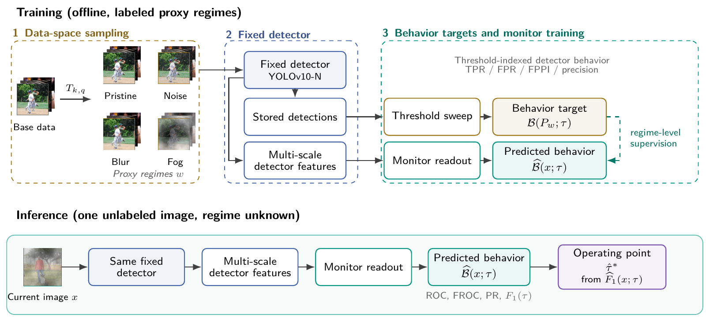

# Detector Operating Behavior Inference via Data-Space Sampling

Stefan Becker, Simon Weiss, Wolfgang Hübner

## Abstract

A detector scores candidate detections, but the recall and false alarms at a given confidence threshold
depend on the input distribution. We introduce *Detector Operating Behavior Inference* (DOBI), a second-level
inference task: estimating a fixed detector's threshold-dependent, distribution-level operating response from the
internal evidence of a single unlabeled image. DOBI treats the detector's threshold response, i.e. recall, false
positives, and precision across thresholds, as a latent behavioral state under the current data condition.
Controlled data-space sampling probes this state space offline, and a lightweight monitor learns the inverse map from
one image to this state, whose single functional output supports multiple operating policies. In a controlled proof
of concept with a fixed YOLOv10-Nano person detector and COCO-derived degradations, predicted PR behavior reduces mean
absolute deviation from 0.128 for an image-independent mean-behavior prior to 0.054, and predicted functional
distances track empirical regime distances (Spearman 0.96). From one unlabeled image, the inferred behavior selects
operating points as well as a non-deployable lookup that knows the true regime (macro-regime F1 0.6604 for both,
versus 0.6407 under pristine calibration; oracle 0.6620). It also supports validation-calibrated FPPI-constrained
operation. On this discrete benchmark, regime-supervised curve lookups are strong controls. Pre-specified continuous
and compositional probing shows where functional inference matters: on unseen combinations, the functional
decoder has a lower mean curve error than a template lookup, increasingly with distance from the training conditions,
whereas the lookup is more accurate for interpolation. These results establish the feasibility of single-image
inference of distribution-level detector behavior over the probed conditions.



*Training probes the frozen detector on degraded image sets and learns to read their behavior from detector features; at inference, one image yields the predicted threshold response and an operating point.*
Thumbnails: COCO images (Flickr terms of use).

## Quickstart

### (a) Install

```bash
conda env create -f environment.yml        # exact versions used for the paper (Python 3.12, PyTorch 2.10, Ultralytics 8.4.12)
conda activate dobi                        # CPU-only machine: CONDA_OVERRIDE_CUDA="" conda env create -f environment.yml
pip install --no-deps -e .
pytest                                     # unit tests, CPU, a few seconds
```

### (b) Regenerate all tables and figures (no datasets, weights or GPU)

```bash
python make_all_tables_figures.py          # about 25 s on a CPU; writes outputs/tables and outputs/figures
```

The script regenerates every table of the paper that is produced from result files and compares it byte for byte
with `reference/tables/`. It ends with

```
tables: 35/35 identical to reference/tables (4 hand-written tables have no generator; sources in outputs/make_all_report.json)
figures: 26 files written to outputs/figures
  skipped, input not included: ...
PASSED
```

The skipped figures need input files that are not part of this version (see [Contents](#contents)).

### (c) DOBI on your own image

Download `yolov10n.pt` and a monitor head (for example `tau_pchip_s0.pt` from the GitHub release) into `weights/`
([weights/README.md](weights/README.md)), then:

```bash
python examples/image_to_curve.py --image my_image.jpg --detector weights/yolov10n.pt --monitor weights/tau_pchip_s0.pt --plot curve.png
```

It prints the predicted recall, FPR, FPPI, precision and F1 at several thresholds, the threshold with the highest
predicted F1 and the lowest threshold with predicted FPPI ≤ 0.1, and plots the predicted curves. CPU is fine.

### (d) The core without Ultralytics

The monitor heads, decoders, curve metrics and targets are Apache-2.0 and run without Ultralytics:

```python
import torch
from dobi.models.monitor_factory import build_monitor_head, decode_monitor_output
from dobi.utils.tau_spline import select_operating_threshold

ckpt = torch.load("weights/tau_pchip_s0.pt", map_location="cpu", weights_only=True)
args = ckpt["train_args"]
head = build_monitor_head(args["head"], [64, 128, 256], args).eval()   # YOLOv10-N feature channels
head.load_state_dict(ckpt["monitor_state_dict"])
feats = [torch.rand(1, c, 20, 20) for c in (64, 128, 256)]           # detector feature maps of one image
tau = torch.as_tensor(ckpt["tau_grid"])
with torch.no_grad():
    curves = decode_monitor_output(args["head"], head, head(feats), tau, u_max=2.0)  # recall_tau, fppi_tau, f1_tau, ...
tau_f1, _ = select_operating_threshold(tau, curves, "f1")
```

A complete runnable version, which also builds operating curves and oracle thresholds from detections, is
`python examples/core_without_ultralytics.py [--monitor weights/tau_pchip_s0.pt]` (synthetic inputs, no data).

### (e) Full pipeline of the main study

Needs COCOMiniPerson-D with its YOLO labels ([DATA.md](DATA.md)), `weights/yolov10n.pt` and a GPU for the detector
steps. Data locations are read from `configs/paths.yaml` (copy `configs/paths_TEMPLATE.yaml`; keys `dobi_db`,
`coco_mini_person_d`, `tau_behavior_models`).

| Step | Entry point | Configuration |
|---|---|---|
| Image variants | `src/dobi/degradation/generator.py` | [DATA.md](DATA.md) §3–5 |
| Detections | `python -m dobi.data.database.detect_variants` | settings fixed in the script, recorded in `detect_protocol.json` |
| Database | `python -m dobi.data.database.generate_db`, `generate_subsets`, `generate_curves` | `configs/regime_subsets.json` (18 regimes) |
| Feature cache | `python -m dobi.data.feature_cache` | frozen YOLOv10-N, input 640 |
| Training and evaluation | `experiments/main_study/scripts/run_paper_experiments.py` | `configs/paper_main.json`, `paper_ablations.json`, `paper_appendix.json` |
| Curve-fit and operating-point results | `python -m dobi.eval.aggregate_paper_results`, `python -m dobi.eval.run_execution_eval` | bootstrap 2,000 resamples, seed 12345 |
| Extended evaluation A–D | `python -m dobi.eval.extended.run_extended_eval` | – |

```bash
D=/path/to/COCOMiniPerson-D/data           # coco_mini_person_d/data
DB=/path/to/dobi.db                        # dobi_db
C=/path/to/TauBehavior                     # tau_behavior_models
for s in train val test; do
  python -m dobi.data.database.detect_variants --weights weights/yolov10n.pt --split_root $D/${s}2017
done
python -m dobi.data.database.generate_db --db $DB --dataset_root $D
python -m dobi.data.database.generate_subsets --db $DB --config configs/regime_subsets.json --splits train val test
python -m dobi.data.database.generate_curves --db $DB
python -m dobi.data.feature_cache --db $DB --images_root $D/train2017/images --out $C/feature_cache
python experiments/main_study/scripts/run_paper_experiments.py --config configs/paper_main.json --stage both
python -m dobi.eval.aggregate_paper_results --eval_root runs/main_study/eval --out runs/main_study/paper_artifacts
python -m dobi.eval.run_execution_eval --db $DB --feature_cache $C/feature_cache --project $C/paper --old_eval_root runs/main_study/eval --old_artifacts runs/main_study/paper_artifacts --out runs/main_study/paper_artifacts_execution --n_boot 2000 --boot_seed 12345
python -m dobi.eval.extended.run_extended_eval --out results/main_study/paper_artifacts_extended_eval/my_run
```

`run_paper_experiments.py --dry-run` prints the training and evaluation commands of every run. Training and
evaluation run on the GPU.

## Contents

| Part | Code |
|---|---|
| Data: COCOMiniPerson-D image list and splits, regime definitions | `datasets/cocominiperson_d/`, `configs/regime_subsets.json`, [DATA.md](DATA.md) |
| Degradation generator: 17 ImageNet-C types, explicit parameters and random state | `src/dobi/degradation/` |
| Detections and database: detector inference, SQLite database, regime subsets, operating points | `src/dobi/data/database/` |
| Feature cache of the frozen detector and data loading | `src/dobi/data/feature_cache.py`, `src/dobi/data/dataloader/` |
| Monitor heads and decoders: functional decoder (PCHIP / linear), PC1 baseline, legacy heads | `src/dobi/models/`, `src/dobi/utils/tau_spline.py`, `src/dobi/utils/spline_helpers.py` |
| Behavior targets and curve metrics | `src/dobi/utils/tau_targets.py`, `src/dobi/utils/roc_db_helpers.py` |
| Training | `src/dobi/training/` |
| Evaluation and statistics: curve fit, operating-point execution, extended evaluation A–D, bootstrap | `src/dobi/eval/` |
| Tables and figures from the result files | `make_all_tables_figures.py`, `experiments/main_study/scripts/`, `scripts/`, `results/`, `reference/tables/` |
| Examples | `examples/` |
| Tests | `tests/` |
| Paper terms vs. names in the code | [GLOSSARY.md](GLOSSARY.md) |

Not included in this version: the experiment pipelines of the follow-up studies, the continuous-probing experiments
and the BDD100K study (their result files and table generators are included). Not regenerated from this repository:
Fig. 1 (a schematic, shown above), the figures that need the regime-level curve exports
(`results/main_study/paper_artifacts/curve_exports/*.npz`: Fig. 2, the full-behavior and fog figures of the
supplement) or the extended-evaluation matrices (`expB_matrices_and_curves.npz`: two supplement figures), and the
supplement figure with dataset images. Four paper tables and six small tables in the supplement text were written by
hand; `make_all_tables_figures.py` lists the result file each was transcribed from.

## Data

COCOMiniPerson-D is built from COCO-2017 with the recipe and the authoritative image list in [DATA.md](DATA.md). No
images or annotations are included. BDD100K is used by reference only.

## Weights

No weights are stored in this repository. The detector is the unchanged Ultralytics YOLOv10-N release; the 12 monitor
heads of the main study are attached to the GitHub release. URLs and SHA-256: [weights/README.md](weights/README.md).

## Numerical precision

Detector inference for the main study used fp32 tensors without half precision or autocast, with PyTorch's default
FP32 matrix multiplication and default cuDNN convolutions, which may use TF32. Monitor heads were trained with fp16
mixed precision (autocast with gradient scaling) and TF32 matrix multiplication (PyTorch 2.10), without deterministic
algorithms. Evaluation ran the trained heads in fp32 with FP32 matrix multiplication. The precision of the
continuous-probing experiments is described in the supplement of the paper.

## Reproducibility

| Part | Status |
|---|---|
| Tables from the result files | byte-identical to the paper (35/35) |
| Image list, splits, pristine images, 7 deterministic degradation types | bitwise identical to the stored images ([DATA.md](DATA.md) §6) |
| Stochastic degradation types | same distribution, not the same pixels (the original run used an unseeded random state) |
| Detections (`detect_variants.py`) | close, not bitwise: on 50 test images from 10 regimes (RTX 5090, PyTorch 2.10, Ultralytics 8.4.12), 99.7% of the 6,703 stored detections matched with IoU ≥ 0.95 and score difference ≤ 0.002 (median 6×10⁻⁶); detections per image differed by at most two, only near the 0.001 score floor. TF32 convolutions depend on the GPU and library versions. |
| Released monitor heads | weights bitwise identical to those used for the paper; predictions identical on 2,000 cached feature vectors |

Results in the paper refer to the stored images and detections.

## Citation

If you use this code in academic work, please consider citing the following paper:

```bibtex
@misc{becker2026dobi,
  title         = {Detector Operating Behavior Inference via Data-Space Sampling},
  author        = {Stefan Becker and Simon Weiss and Wolfgang H{\"u}bner},
  year          = {2026},
  eprint        = {ARXIV_ID},
  archivePrefix = {arXiv},
  primaryClass  = {cs.CV},
  url           = {https://arxiv.org/abs/ARXIV_ID}
}
```

## License

* DOBI core – the modules that use neither Ultralytics nor code derived from it (monitor heads and decoders, curve
  metrics and targets, lookup controls, degradation generator, statistics, plotting helpers): Apache-2.0
  (`LICENSES/Apache-2.0.txt`, `NOTICE`). These files import only numpy, pandas, scipy, scikit-image, OpenCV, Pillow,
  matplotlib, PyYAML, tqdm, torch, torchvision and Wand (plus the frost textures of imagecorruptions) and can be used
  without Ultralytics.
* Everything else: AGPL-3.0-or-later (`LICENSE`). Feature extraction, detector inference, data loading, training and
  evaluation build on the Ultralytics package (AGPL-3.0) or contain code adapted from it; code combined with it is
  distributed under the same license. Under AGPL-3.0, using this code in a product or a network service requires
  releasing the complete source of that application under AGPL-3.0; Ultralytics offers a commercial license as an
  alternative.
* Every source file states its license in an SPDX header. Third-party code and dependencies: `THIRD_PARTY_NOTICES.md`.
* Datasets and weights: COCO and COCOMiniPerson-D (derived from COCO-2017) and BDD100K are not redistributed; see
  [DATA.md](DATA.md). The detector weights are the unchanged Ultralytics releases (AGPL-3.0) and are not included.
  The monitor heads were trained by us on features of the frozen detector and are published with the GitHub release
  ([weights/README.md](weights/README.md)).

This note is for orientation only and is not legal advice.
